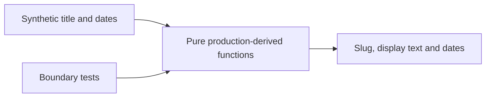

# Article Workflow Lab

Production-derived JavaScript utilities for normalizing article text and slugs while keeping publication dates separate from research cutoffs.

## Why this exists

My Ayotte Technologies website uses a structured article workflow to keep drafts, generated pages and discovery metadata consistent. This small repository exposes selected pure functions so reviewers can evaluate real source without receiving the production website, client material, article drafts or cloud configuration.

## What is included

HTML escaping, text/word extraction, slug generation and publication/research-date normalization from the private website tooling. A synthetic CLI example and focused tests show the behavior. The full website also implements transactional publishing and rollback, but those components are not included or claimed to run here.

## Architecture and decisions



Keeping these functions independent of file writes and cloud services makes the rules inspectable. Research cutoff and publication date remain separate fields. Slug normalization is convenient but can create collisions; the full publishing layer must enforce uniqueness. HTML tag removal is text extraction, not a security sanitizer. Do not use these utilities as a boundary for untrusted HTML.

## Implementation status

The utilities are extracted from implemented private source. The standalone wrapper, examples and tests were created for this showcase. This repository's tests cover only the extracted subset. No live publication or storage integration is included.


## Run the code in this repository

Requires Node.js 22 or newer (validated on Node.js 24). No package installation, credentials, network connection or deployment is needed.

```text
npm test
npm run demo
```

See [source provenance, scope and evaluation](CODE-REVIEW.md). The six passing tests exercise the standalone code, not the private production system. This repository has no deployment workflow.

## Review and maintenance

The standalone tests run in a test-only GitHub Actions workflow with read-only repository access, no deployment and no production secrets. They do not establish live-system acceptance. Report a suspected sensitive-data exposure privately to [Michael E. Ayotte](https://github.com/MichaelEAyotte); do not place the sensitive value in an issue.

## License and commercial permission

The current owner-controlled, protectable source, tests, fictional examples and original documentation are offered under the [PolyForm Noncommercial License 1.0.0](LICENSE). This is **source-available software, not OSI-approved open-source software**. Read the official license for its permitted purposes and conditions, and retain the [required notice and scope](NOTICE).

Noncommercial use, modification and redistribution are permitted subject to the license. Commercial use outside the purposes permitted by that license requires separate written permission from [Michael E. Ayotte](https://github.com/MichaelEAyotte). No permission is implied by this repository's public visibility.

Previously published MIT versions remain available with their existing permissions, including commercial use and redistribution. The unchanged code can still be obtained from those historical commits under MIT; this change does not revoke those permissions or create exclusive commercial rights over those copies. See [publication history and licensing scope](PUBLICATION.md) and [contribution terms](CONTRIBUTING.md).
